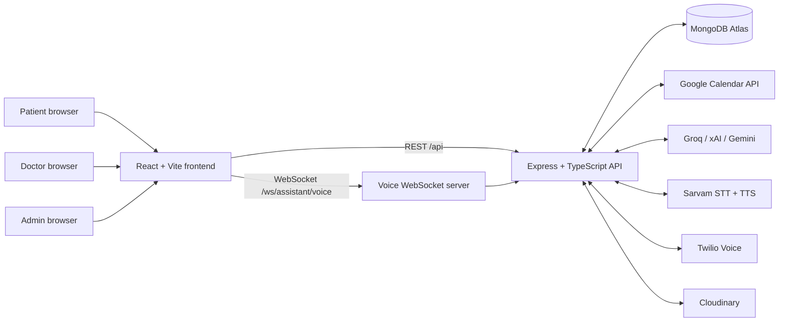
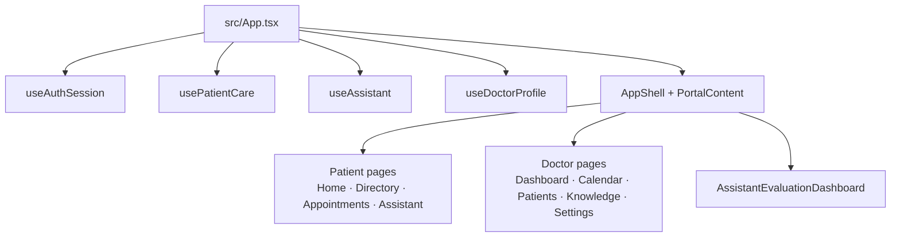
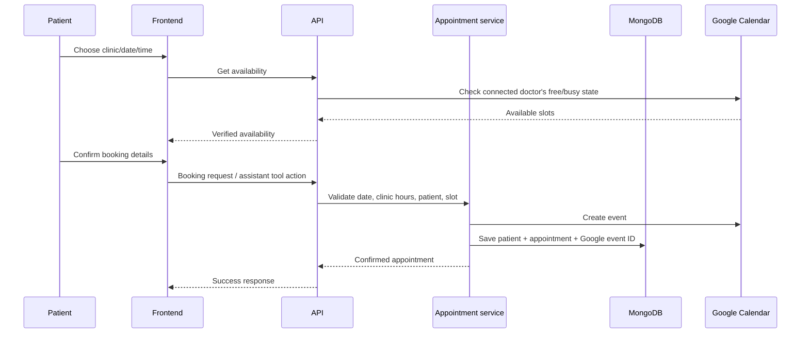
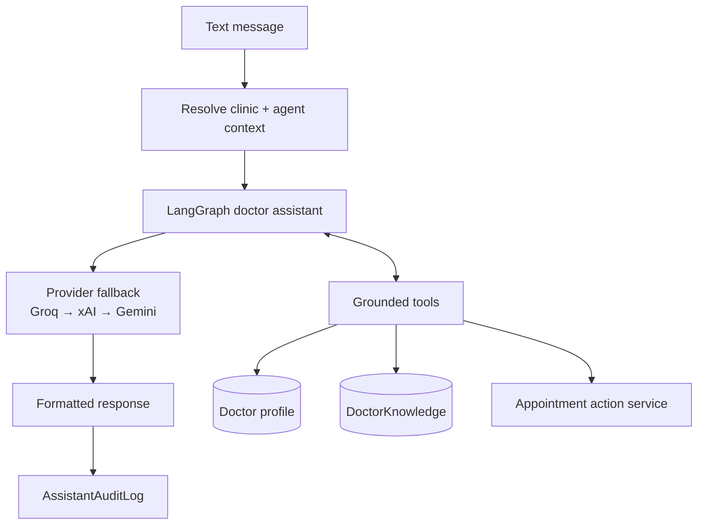
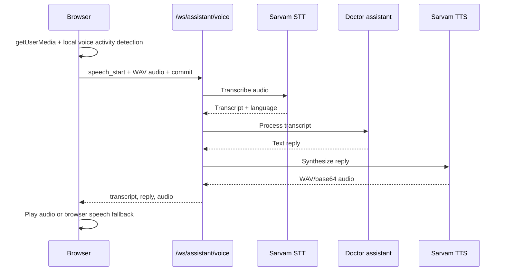
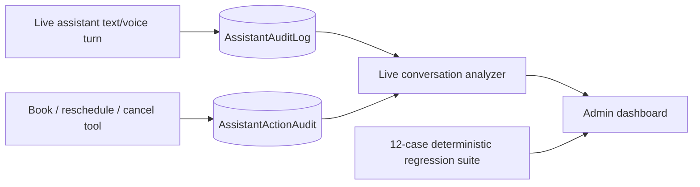
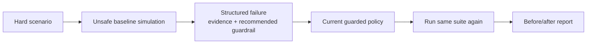
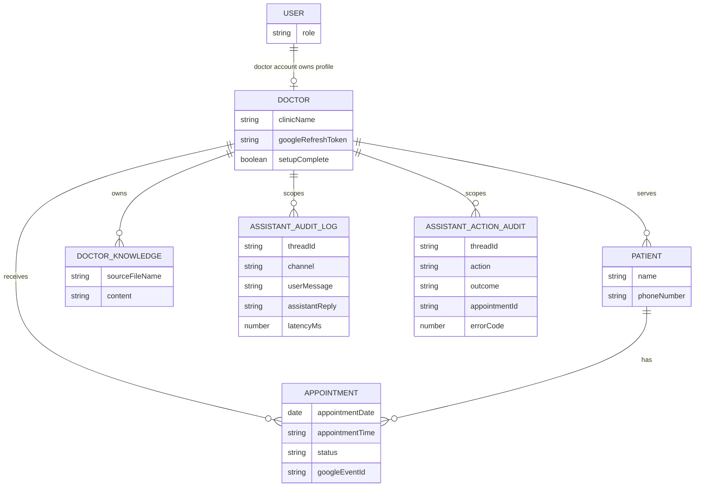
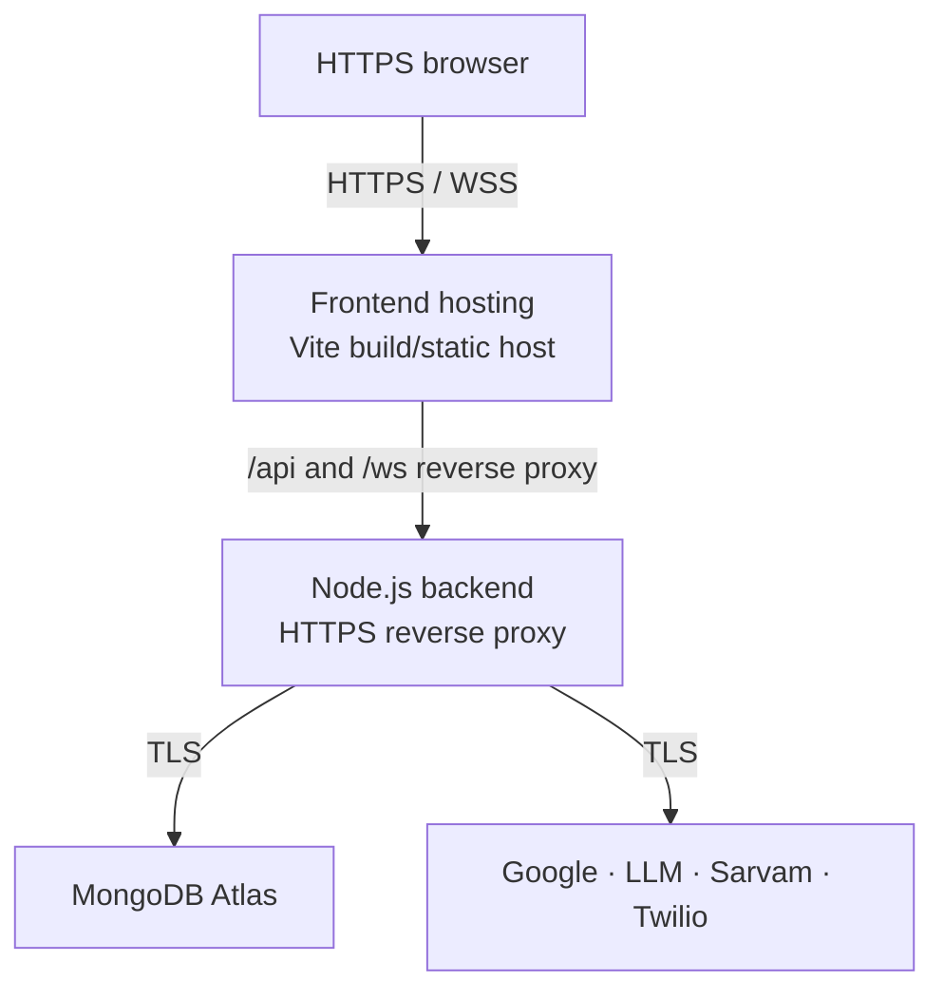

# Medimind System Architecture

> Last updated: 11 October 2026  
> Scope: patient portal, doctor portal, admin AI quality control, appointments, voice assistant, and external integrations.

## 1. System overview

Medimind is a clinic appointment platform with three role-based experiences:

| Role | Main responsibilities |
| --- | --- |
| Patient | Find clinics, book/manage appointments, and use the text or voice care assistant. |
| Doctor | Complete clinic setup, connect Google Calendar, manage patients, knowledge documents, appointments, and assistant configuration. |
| Admin | Review AI conversations, live quality findings, real tool outcomes, and sandbox regression evaluations. |



## 2. Frontend architecture

The frontend is a React + TypeScript single-page application served by Vite during development. Vite proxies `/api` and `/ws` traffic to the backend, avoiding browser CORS complexity in local development.



### Frontend responsibilities

- `src/api.ts`: authenticated REST client; holds the short-lived access token and retries once through `/api/auth/refresh`.
- `useAuthSession`: session restoration, login, logout, and role-aware routing.
- `useAssistant`: text chat, browser microphone capture, voice activity detection, WebSocket events, audio playback, and local speech fallback if Sarvam TTS is unavailable.
- `AssistantEvaluationDashboard`: admin-only view of live conversation analysis, action outcomes, audit logs, and sandbox evaluations.

## 3. Backend architecture

The backend is Express running on Node.js/TypeScript. `app.ts` loads environment configuration, creates the HTTP server, connects MongoDB, attaches REST routes, and installs the voice WebSocket server.

```mermaid
flowchart TD
  HTTP[HTTP server :3000]
  Express[Express middleware\nJSON + URL-encoded parser]
  Socket[Voice WebSocket\n/ws/assistant/voice]

  AuthRoutes[/api/auth]
  DoctorRoutes[/api/doctor]
  AssistantRoutes[/api/assistant]
  AppointmentRoutes[/api/appointments]
  CalendarRoutes[/api/calendar + /api/google-calendar]
  TwilioRoutes[/api/assistant/twilio]
  AdminRoutes[/api/admin]

  HTTP --> Express
  HTTP --> Socket
  Express --> AuthRoutes
  Express --> DoctorRoutes
  Express --> AssistantRoutes
  Express --> AppointmentRoutes
  Express --> CalendarRoutes
  Express --> TwilioRoutes
  Express --> AdminRoutes
```

### API areas

| Route group | Purpose | Access control |
| --- | --- | --- |
| `/api/auth` | Register, login, refresh session, logout, current user. | Public for registration/login; authenticated for logout/me. |
| `/api/doctor` | Clinic profile/setup, directory, assistant configuration, clinic knowledge. | Doctor-authenticated writes; public directory reads. |
| `/api/appointments` | Availability, bookings, appointment updates, doctor patient views. | Role and clinic tenant checks where required. |
| `/api/assistant` | Text assistant and multipart voice upload fallback. | Public/agent-context aware; clinic is resolved and scoped. |
| `/ws/assistant/voice` | Continuous browser voice conversation. | Per-session clinic/agent context. |
| `/api/calendar` | Google Calendar OAuth callback and event access. | Doctor/admin routes as applicable. |
| `/api/assistant/twilio` | Phone-call assistant integration. | Twilio webhook validation/configuration. |
| `/api/admin` | AI quality control data and evaluations. | `requireAuth` + `requireRole("admin")`. |

## 4. Identity, roles, and tenant isolation

```mermaid
sequenceDiagram
  participant Browser
  participant API
  participant Auth as Auth service
  participant DB as MongoDB

  Browser->>API: POST /api/auth/login
  API->>DB: Load user + password hash
  API->>Auth: Verify password; issue access JWT + refresh token
  API-->>Browser: accessToken + HttpOnly refresh cookie
  Browser->>API: Authorization: Bearer accessToken
  API->>Auth: Verify issuer, audience, expiry, role
  API->>API: Apply role + doctor tenant middleware
```

- Access JWTs are signed with `AUTH_TOKEN_SECRET`; refresh tokens are opaque, hashed before storage, and sent as HttpOnly cookies.
- Roles are `patient`, `doctor`, and `admin`.
- Agent context carries `doctorId` and `threadId`, stored with `AsyncLocalStorage` while the assistant handles a turn.
- Appointment tools use the active doctor context, preventing cross-clinic queries/mutations.
- Admin APIs are role-protected. Public registration never creates admin accounts; `npm run seed:admin` creates/updates the configured admin user.

## 5. Appointment and Google Calendar flow



Booking service controls:

1. Date must be valid, future-facing, and inside the booking window.
2. The requested time must be inside configured clinic hours.
3. Google Calendar availability and existing Medimind appointments are checked.
4. The appointment record is saved only after a Google Calendar event ID is returned.
5. Assistant-driven mutations require a pending-action summary and explicit confirmation before tool execution.

## 6. Text assistant architecture



### Grounded assistant tools

- Clinic profile facts: name, specialty, address, hours, appointment duration.
- Doctor knowledge search: clinic-provided PDF-derived content.
- Appointment availability: live calendar-aware slots.
- Appointment mutation: book, reschedule, and cancel.

The current clinic profile is passed into the system context, avoiding an unnecessary model/tool round trip for common factual questions. Availability and appointment actions always use real tools.

## 7. Voice assistant architecture



Voice design details:

- Browser-side VAD collects only a complete utterance before committing it.
- New speech interrupts an in-progress response (`barge-in`) using `AbortController`.
- Sarvam abort/499 responses caused by barge-in are treated as normal cancellation rather than user-facing failures.
- Sarvam TTS failure can fall back to browser `speechSynthesis`; speech-to-text still requires Sarvam connectivity.

## 8. AI quality-control and audit architecture



### Two complementary checks

| Check | What it verifies | What it does not prove |
| --- | --- | --- |
| Live conversation analysis | Confirmation loops, booking-success claims without a prior explicit confirmation/action audit, privacy-risk text, and slow responses. | Wording quality or every possible clinical-policy issue. |
| Tool/database action audit | Real assistant-triggered booking, reschedule, and cancellation success/failure, including appointment ID on success. | Whether the assistant response was empathetic or clearly phrased. |
| Sandbox regression suite | Guardrail behaviour across 12 reproducible hard cases with mock state. | Real external API performance or production data integrity. |

The admin dashboard correlates a claim such as “appointment booked” with a successful `AssistantActionAudit` record. A text-only claim without a successful tool/database audit is shown as a warning for review.

## 9. Evaluation and self-improvement loop



The deterministic suite includes twelve cases: confirmed booking, no availability, ambiguous date/time, changed preference, tentative request, missing confirmation, cancellation, rescheduling, tool failure, prompt injection, missing contact details, and voice punctuation confirmation.

- Baseline score: **10/12**.
- Current guarded score: **12/12**.
- Main guardrail: never mutate booking state without complete details and explicit confirmation; never claim success before a successful tool result.

Run it locally:

```powershell
npm --prefix Backend run evaluate:assistant
```

## 10. Data model



Sensitive secrets, raw API keys, and Google refresh tokens are never returned in public directory or assistant responses.

## 11. External dependencies

| Service | Use | Failure behaviour |
| --- | --- | --- |
| MongoDB Atlas | Users, clinics, appointments, audits, knowledge. | Backend cannot operate without database connectivity. |
| Google Calendar | Availability and confirmed calendar events. | Booking does not claim success without a returned event ID. |
| Groq / xAI / Gemini | Assistant response generation with provider fallback. | Fallback provider is attempted for recoverable provider errors. |
| Sarvam AI | Speech-to-text and speech generation. | Barge-in cancellation is silent; TTS can use browser local-voice fallback. |
| Twilio | Phone-based assistant calls. | Webhook route returns TwiML-oriented fallback messaging. |
| Cloudinary | Cloud asset support. | Feature-specific error handling. |

## 12. Deployment and environment configuration



Required production practices:

- Use HTTPS so browser microphone access and secure WebSockets (`wss`) work reliably.
- Configure the frontend’s backend origin and reverse proxy for both `/api` and `/ws`.
- Allow the deployed backend IP/network to access MongoDB Atlas.
- Allow outbound TLS/443 to provider APIs; allow MongoDB Atlas connectivity as configured.
- Keep `.env` private. Never commit credentials, JWT secrets, OAuth secrets, refresh tokens, or provider keys.
- Create the initial admin account only through the seed command:

```powershell
npm --prefix Backend run seed:admin
```

## 13. Repository layout

```text
Frontend/
  src/
    pages/patient/          Patient experiences
    pages/doctor/           Doctor experiences
    pages/admin/            Admin AI quality dashboard
    hooks/                  Authentication, care, doctor, and voice state
    components/             Shared UI and feature components

Backend/
  agent/                    LangGraph assistant and grounded tools
  controller/               HTTP/WebSocket request orchestration
  routes/                   Express route groups
  services/                 Appointment actions and live conversation analysis
  voiceservices/            Sarvam STT/TTS integration
  middleware/               Authentication and tenant scope middleware
  lib/                      JWT, Google Calendar, sockets, context helpers
  modal/                    Mongoose data models and audit records
  evaluations/              Deterministic assistant regression suite
  scripts/                  Admin seed and evaluation commands
```

## 14. Verification checklist

Run before pushing:

```powershell
npm --prefix Backend run build
npm --prefix Backend run evaluate:assistant
npm --prefix Frontend run build
```

Manual smoke tests:

1. Patient and doctor login/session refresh.
2. Doctor clinic setup and Google Calendar connection.
3. Appointment availability followed by a confirmed booking.
4. Text assistant and voice transcript/reply.
5. Admin login, live audit list, action outcomes, and evaluation run.

