# Medimind System Architecture

> Last updated: 11 October 2026

## 1. High level architecture

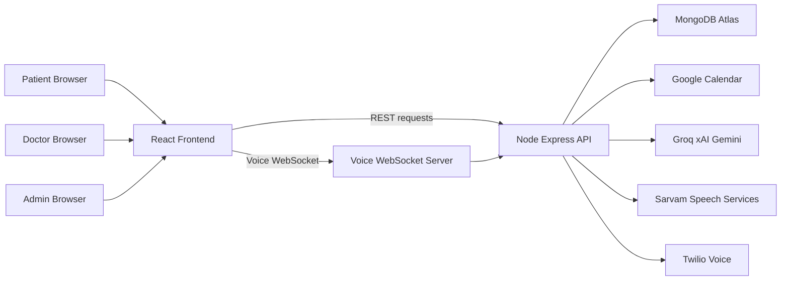

## 2. Frontend structure

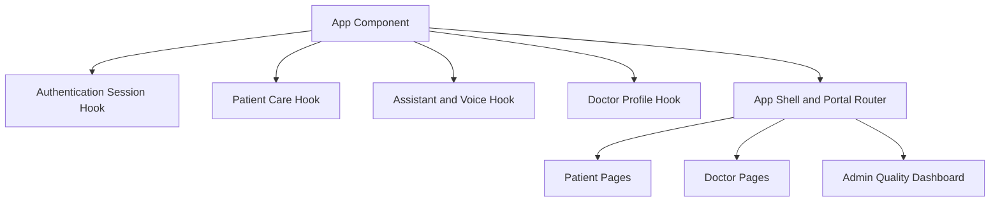

The React frontend provides role-aware pages. `src/api.ts` sends authenticated API calls and refreshes expired access tokens. `useAssistant.ts` handles text chat, microphone capture, voice activity detection, WebSocket messages, and audio playback.

## 3. Backend route layout

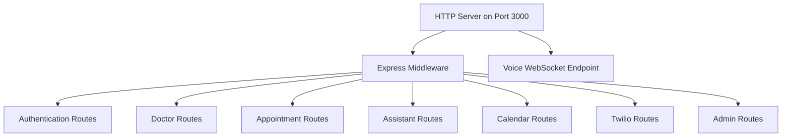

| Area | Responsibility |
| --- | --- |
| Authentication | Login, registration, refresh token, logout, current session. |
| Doctor | Clinic profile, setup, assistant configuration, knowledge uploads. |
| Appointment | Availability, booking, reschedule, cancellation, doctor patient list. |
| Assistant | Text assistant, voice upload fallback, and voice WebSocket. |
| Calendar | Google OAuth and calendar event access. |
| Admin | AI conversations, live analysis, real action audits, regression evaluations. |

## 4. Authentication and tenant isolation

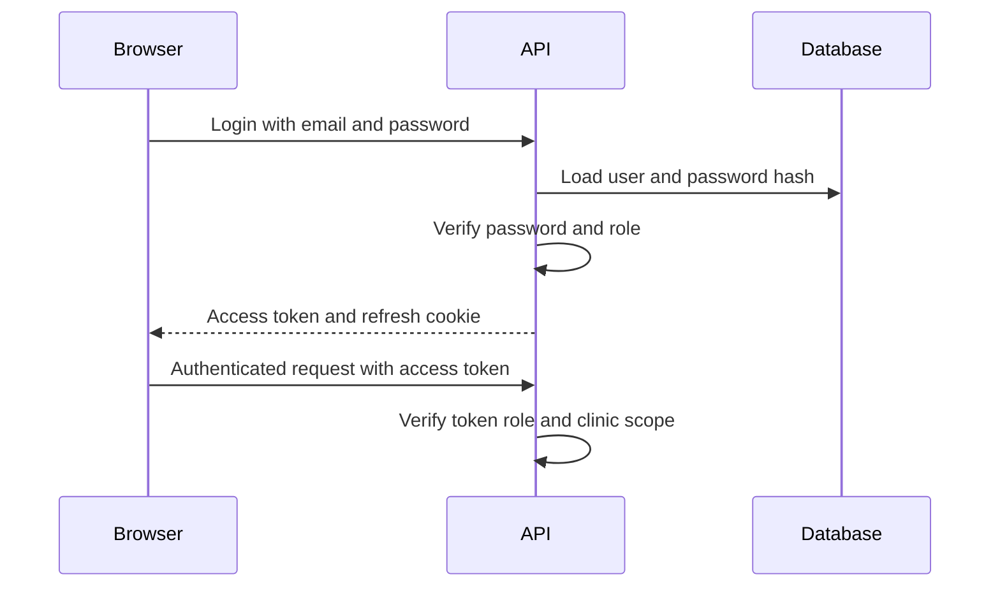

- Roles are `patient`, `doctor`, and `admin`.
- Access tokens are JWTs. Refresh tokens are opaque values stored as hashes and sent in HttpOnly cookies.
- Doctor and assistant operations use a `doctorId` tenant context so a clinic cannot query or mutate another clinic’s records.
- Admin routes require both authentication and the `admin` role.

## 5. Appointment and calendar flow

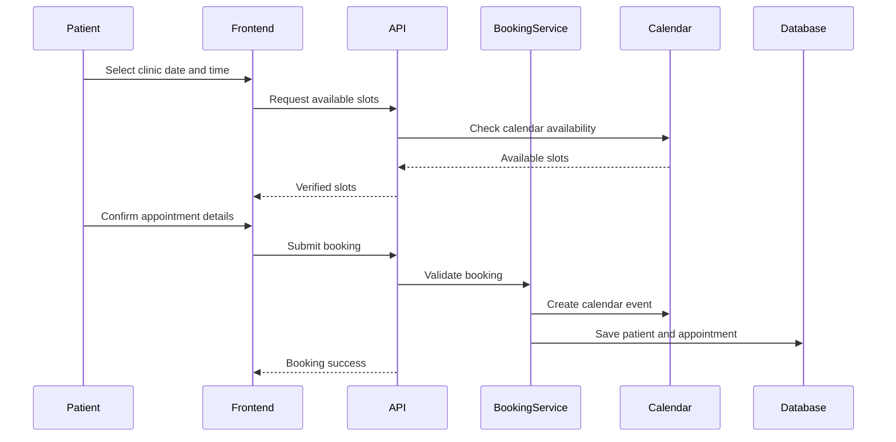

Booking guards:

1. Date must be valid, future-facing, and within the booking window.
2. The time must be inside clinic working hours.
3. Google Calendar and existing Medimind appointments are checked for conflicts.
4. A booking is not reported as successful until the calendar event ID and appointment record are saved.

## 6. Text assistant architecture

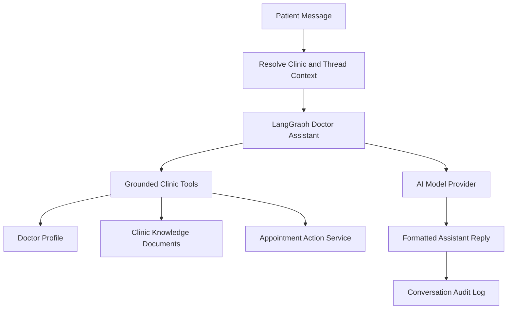

The provider fallback order is Groq, then xAI, then Gemini for recoverable provider failures. Availability, booking, cancellation, rescheduling, and knowledge search use controlled backend tools rather than model guesses.

## 7. Voice assistant architecture

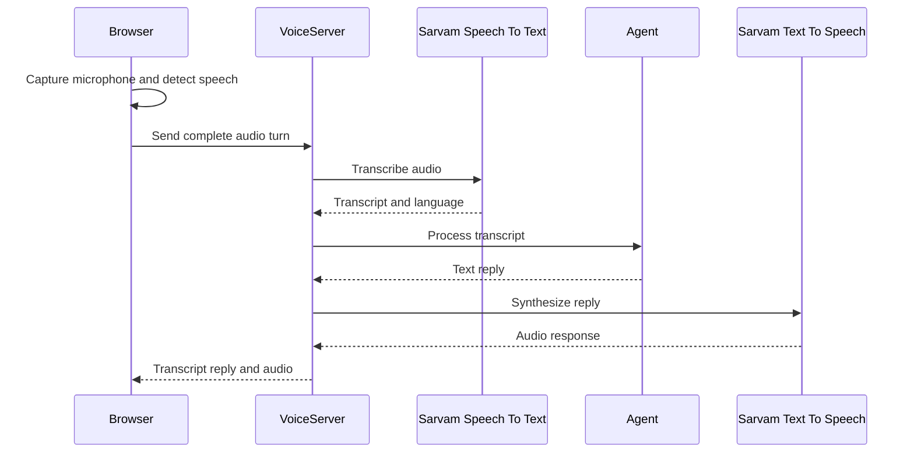

- Browser voice activity detection commits an utterance after speech ends.
- New speech cancels the active reply. This is expected barge-in behaviour.
- Sarvam TTS failure can use browser speech synthesis for the text reply.

## 8. AI quality and audit architecture

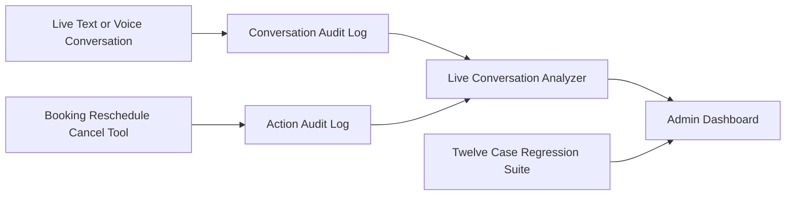

| Source | Proves |
| --- | --- |
| Conversation audit | What the user and assistant said, the channel, timestamp, and latency. |
| Action audit | Whether a real assistant-triggered booking, reschedule, or cancellation succeeded or failed. |
| Regression suite | Whether known safety rules pass in deterministic mock scenarios without touching live data. |

The live analyzer flags confirmation loops, privacy-risk phrasing, slow responses, and booking-success claims without matching successful action audits.

## 9. Evaluation loop

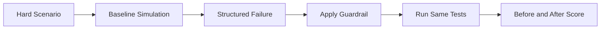

The regression suite covers confirmed booking, unavailable slots, unclear date/time, changed preferences, tentative requests, cancellation, rescheduling, tool failure, prompt injection, missing details, and voice punctuation. The current comparison is **10/12 before** and **12/12 after** the guardrail.

## 10. Data model

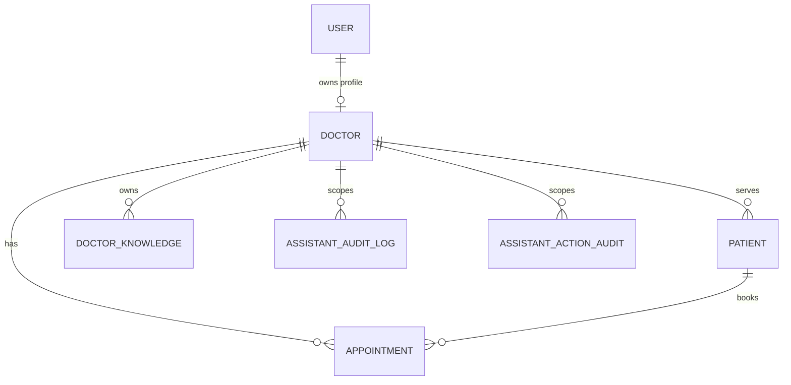

Main MongoDB collections are Users, Doctors, Patients, Appointments, DoctorKnowledge, AssistantAuditLog, and AssistantActionAudit. Provider secrets and Google refresh tokens are never returned in public directory or assistant responses.

## 11. Deployment boundary

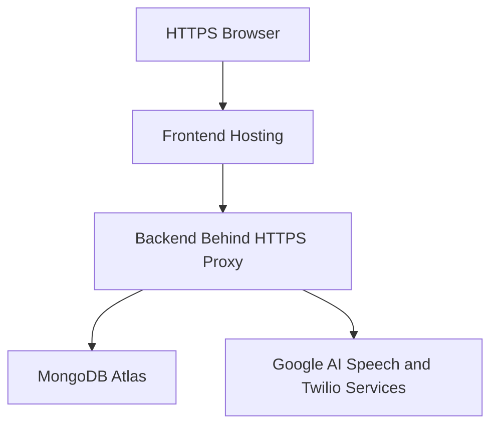

Production requires HTTPS for microphone permissions and secure WebSockets. The backend must have permitted outbound access to MongoDB Atlas and provider APIs.

## 12. Validation before push

```powershell
npm --prefix Backend run build
npm --prefix Backend run evaluate:assistant
npm --prefix Frontend run build
```

For detailed role-by-role explanations and feature flows, see [PROJECT_WORK_FLOW.md](./PROJECT_WORK_FLOW.md).
